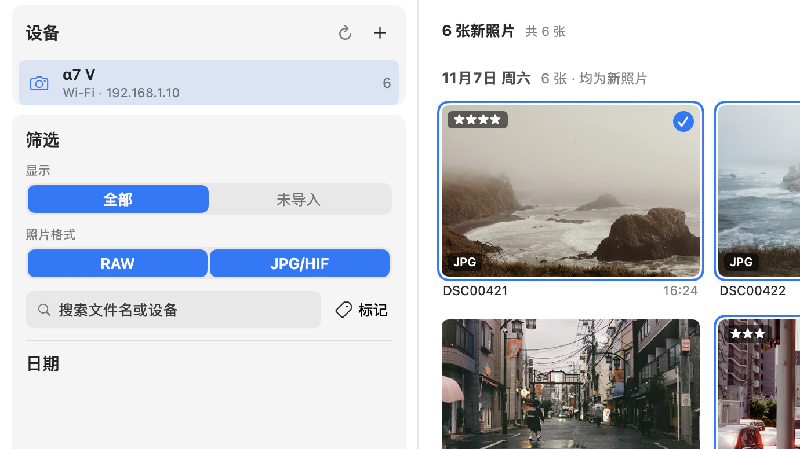
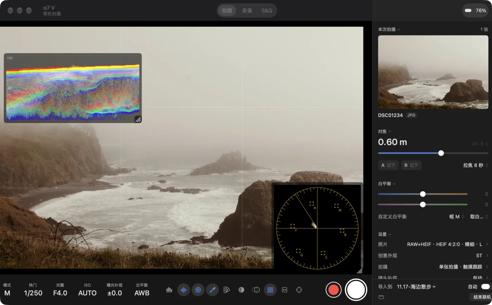
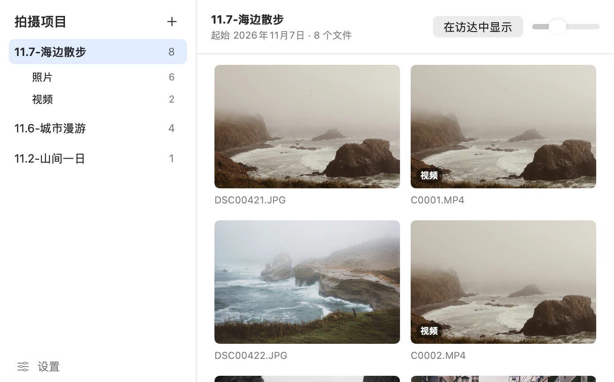
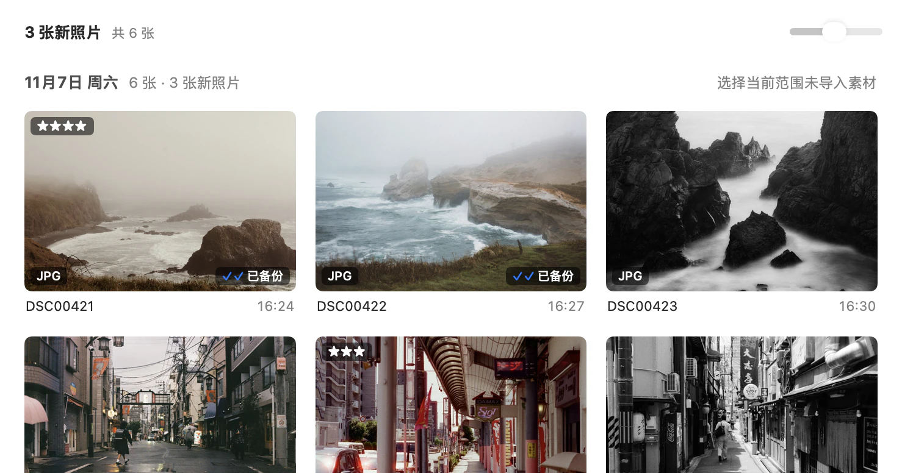

# MiniDiT

MiniDiT 是一个 Mac 应用，用来把相机里的照片和视频导进电脑：通过 Wi-Fi、USB 或读卡器连上相机，挑好素材，导进项目文件夹，顺便备份、校验，再交给 Capture One、Lightroom Classic、DaVinci Resolve 等后期软件。

> 现在是 0.1.1，主要在索尼 α7 V 上用过。佳能、富士、尼康和大疆的存储卡可以用读卡器导入；它们的无线连接已经写好，但还没拿真机试过。需要 Apple 芯片的 Mac 和 macOS 14 以上。后续计划见 [docs/MiniDiT-ROADMAP.md](docs/MiniDiT-ROADMAP.md)。
>
> Sony / 索尼是索尼集团的商标，MiniDiT 与索尼没有关联。PTP/IP 和索尼的扩展协议是根据公开资料自己实现的，参考过 libgphoto2、alpha2go 等开源项目，没有用它们的代码。

## 能做什么

**连接相机**

- 索尼 Wi-Fi：用相机的访问认证（SSH）连接。连过的相机会记住，换了 IP 也认得出。
- USB：接上数据线就能用，不用装驱动。索尼设成“PC 遥控”时可以浏览、导入和联机拍摄；设成“大容量存储”时相当于读卡器。MTP 模式还没实测。
- 联机拍摄（索尼）：实时取景，调快门、光圈、ISO、曝光补偿和白平衡，锁定对焦、录像。拍完的照片按当前项目自动导入。
- 读卡器：插卡就能浏览，也可以设成自动导入。支持 ARW、CR3/CR2、RAF、NEF、DNG 等格式，大疆 Osmo 的 .LRF 当代理一起导。
- 佳能、富士、尼康、大疆的 Wi-Fi（试验）：按各家协议实现了浏览和下载，操作步骤见[功能清单](docs/MiniDiT-FEATURES.md)。
- 可以同时打开几台相机和几张卡，按拍摄时间混在一起看。相机掉线会自动重连，导入中断后能接着传。

**浏览**

- 按日期列出，RAW 和 JPG/HIF 合成一格，也可以按时间间隔分场次。
- 选择方式和访达一样，按空格看大图和拍摄参数。
- 显示机内星级、Shot Mark、视频时长、伽马和帧率，也能按这些筛选。
- 视频可以直接播放、逐帧查看；Wi-Fi 下优先用代理预览。
- 选中的文件可以直接拖到访达；拖到左边的项目上就是正常导入。

**项目、备份与校验**

- 导入前要先选一个项目。照片和视频可以存在不同的地方，各自用自己的目录规则。
- 可以设多个备份位置，每个位置单独校验、单独记录，一个失败不影响其他位置。
- 用 xxHash64 核对文件，备份写完后再读一遍；每个文件夹都生成 ASC MHL 校验清单。Wi-Fi 来源拿不到相机端的校验值，只能核对收到的内容。
- 缺了的备份可以之后补齐，只要还有一份完好的副本，就不用再找原卡。
- 可以导出交接清单（PDF、CSV 和 ASC MHL），见[交接清单](docs/HANDOFF.md)。
- 用读卡器时，可以在导入后删掉卡上的照片，只删校验过、备份完的。

**交给后期**

- 照片：Capture One（建会话，可按创意外观套 Look）、Lightroom Classic（通过插件，RAW+JPG 自动叠放）、DxO PhotoLab（写 .dop），或者只拷到文件夹。
- 相机 Look 的配置文件没装时，会从 [sony-look-bridge](https://github.com/751K/sony-look-bridge) 下载。
- 视频：DaVinci Resolve、Premiere Pro、Final Cut Pro、剪映专业版。视频进入与 MiniDiT 项目同名的工程，代理和 XML 一起带上，保留原片时间码。
- Wi-Fi 导视频时可以只导代理，原片留在卡上。

**后台**

- 关掉窗口后留在菜单栏。连过的相机开机时会发通知，也可以设成自动导入到当前选中的项目。

每项功能的细节和实测情况见 [docs/MiniDiT-FEATURES.md](docs/MiniDiT-FEATURES.md)。

## 下载与安装

1. 从 [GitHub Releases](https://github.com/751K/MiniDiT/releases/latest) 下载最新的 `MiniDiT-<版本>.dmg`。
2. 打开 DMG，把 MiniDiT 拖进「应用程序」。应用经过 Apple 公证，可以直接打开。
3. 用到相关功能时，macOS 会请求权限：
   - **本地网络**：搜索和连接 Wi-Fi 上的相机。
   - **蓝牙**：连接大疆相机时，用蓝牙打开相机的 Wi-Fi。
   - **自动化**：让 Capture One、DaVinci Resolve 等软件导入素材。
   - **照片**：把导出的实况照片存进「照片」。

   不小心点了拒绝，可以到「系统设置 › 隐私与安全性」里重新打开。

MiniDiT 会自动检查更新。也可以用「MiniDiT › 检查更新…」手动检查，或在「设置 › 通用」里关掉自动检查。

## 开始使用

1. 第一次打开会有设置向导，设置照片和视频存在哪、怎么分文件夹、用哪个后期软件、备份到哪。可以先跳过，之后在设置里重新打开。
2. 用 Wi-Fi 连索尼相机时，先在相机上打开 MENU → 网络 → 连接/遥控拍摄 → 遥控拍摄功能 → **遥控拍摄：开**，并连上 Mac 所在的 Wi-Fi。第一次连接要输入相机上显示的用户名和密码，并核对指纹（MENU → 网络 → 网络选项 → 访问认证信息）。相机同时只接受一个遥控端，先断开 Creators' App。
3. 在来源页点相机，或者搜索、输入 IP；插着的存储卡也在这里。中栏右上角的“＋”可以再加相机或卡。
4. 在中栏选日期和筛选条件，在右边勾选素材。只想拿原文件的话，直接拖到访达就行，不需要项目，也不做备份。
5. 在左栏选一个项目，或点“＋”新建，然后点底栏的导入。

## 连接后期软件

**Capture One**：第一次导入时，macOS 会问是否允许 MiniDiT 控制 Capture One，点允许即可。

**Lightroom Classic**：在「设置 › 连接」里点「安装插件」（LrC 开着的话，装完要重启一次），再在「设置 › 照片」里选「导入到 Lightroom Classic」。用读卡器时，建议在 LrC 的「偏好设置 › 常规」里关掉「检测到存储卡时显示导入对话框」。

**DaVinci Resolve**：在 Resolve 的偏好设置里把「外部脚本使用」设为「本地」，再在「设置 › 视频 › 导入至」里打开 DaVinci Resolve。视频会加入与 MiniDiT 项目同名的 Resolve 项目，没有就新建；切换前会先保存 Resolve 当前打开的项目。

**Premiere Pro**（25.6 及以上）：在「设置 › 连接」里点「安装插件…」，由 Creative Cloud 安装；在 PR 的「窗口 › UXP 插件」里打开 MiniDiT 面板，再在「设置 › 视频 › 导入至」里打开 Premiere Pro。详见 [Premiere Pro 连接](docs/PREMIERE.md)。

**Final Cut Pro**：在「设置 › 视频 › 导入至」里打开，并选择把 MiniDiT 项目当作资源库还是事件。

**剪映专业版**：在「设置 › 视频 › 导入至」里打开，视频会放进与项目同名的草稿。剪映打开过的草稿会被加密，之后 MiniDiT 就加不进去了，需要在剪映里手动导入。

发送失败时，可以在「项目 › 导入记录与备份 › 后期软件」里重试，不用重新下载。

## 实况照片

右键视频，选「导出实况照片…」，挑好封面，拖动 In / Out 定范围（默认约 3 秒）。也可以一次导出多段，或按 Shot Mark 批量导出。支持 Apple 实况照片和 Motion Photo，前者可以直接存进「照片」。最高 4K、SDR。详见[实况照片](docs/LIVE-PHOTO.md)。

## CLI 与 Agent

MiniDiT 带有命令行工具和 MCP 服务，脚本或 agent 可以用它查项目和设备、选素材、导入、看进度，也能遥控索尼相机联机拍摄。用法见 [CLI 与 MCP](docs/AGENT-CONTROL.md)。

## 排查问题

「设置 › 通用」里有「复制日志」，包括网络状况、SSH 协商结果、列目录方式和缩略图格式，不含密码。出错提示里会带 PTP 操作码和响应码，可以对照 [docs/PROTOCOL.md](docs/PROTOCOL.md) 查。

## 文档

- [功能清单](docs/MiniDiT-FEATURES.md)
- [产品规划](docs/MiniDiT-ROADMAP.md)
- [开发说明](docs/DEVELOPMENT.md)

## 许可证

[MIT](LICENSE)。随应用分发的 OpenSSL、libssh2 和 Sparkle 使用各自的许可证，见 [THIRD_PARTY_NOTICES.md](THIRD_PARTY_NOTICES.md)，也可以在应用的「MiniDiT › 关于 MiniDiT」里查看。

截图里的照片来自 Unsplash，仅作演示，署名见 [PHOTO-CREDITS.md](Website/minidit/PHOTO-CREDITS.md)。
